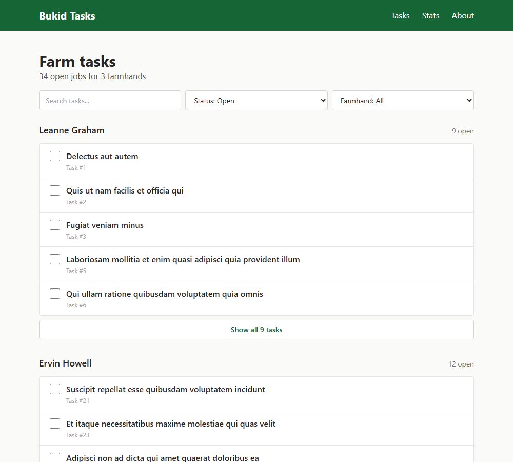
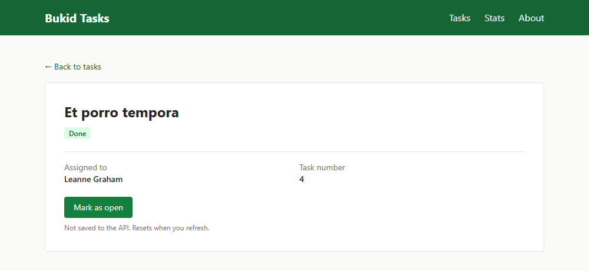
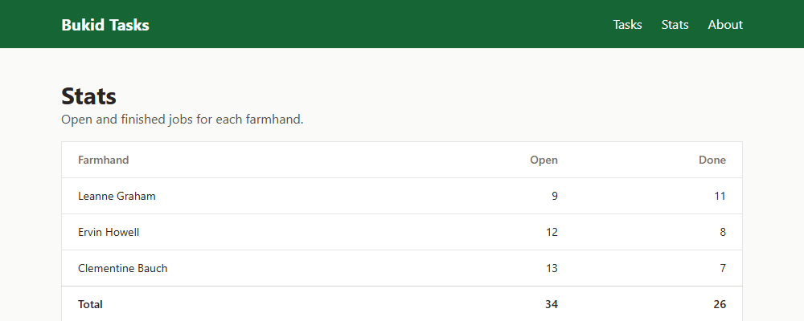
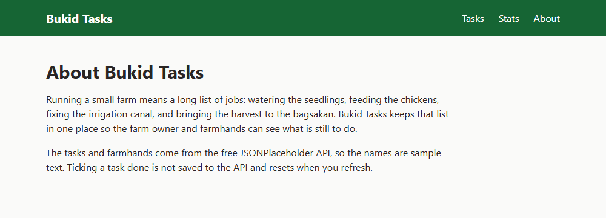

Mini-project 1 - React Task & Productivity Manager

# Bukid Tasks

A simple task list for a small farm. The farm owner can see which jobs are still open for each farmhand and tick them off once they're done.

## Features

- Routes
  - `/` - the task list, grouped by farmhand. Shows open jobs first, with search and filters for status and farmhand.
  - `/tasks/:id` - one task with its status, who it's assigned to and the task number
  - `/stats` - how many open and done tasks each farmhand has
  - `/about` - about the app
  - Any other URL shows a "Page not found" message.
- Public API: [JSONPlaceholder](https://jsonplaceholder.typicode.com). I only load the first 3 users as the farmhands, so the app gets 60 tasks instead of all 200.
  - `/todos?userId=1&userId=2&userId=3` and `/todos/:id`
  - `/users?id=1&id=2&id=3` and `/users/:id`
- TanStack Query + loading/error/empty handling
  - All fetching is done with `useQuery`. Query keys are `['todos']`, `['todos', id]`, `['users']` and `['user', userId]`.
  - The list and stats pages wait for both the tasks and the farmhands before showing anything.
  - Loading shows grey placeholder rows. Error shows a red message. Empty shows "No tasks yet", or "No tasks match your filters" with a Clear filters button.
  - A task id that doesn't exist (like `/tasks/99999`) shows "not found".
  - To test the states, change `FORCE` in `src/api/taskApi.js` to `'slow'`, `'error'` or `'empty'`. Set it back to `null` after.
- Screenshots

  

  

  

  

## Setup

You need Node.js installed.

```bash
git clone https://github.com/markatantonio-cpu/bukid-tasks.git
cd bukid-tasks
npm install
npm run dev
```

Then open http://localhost:5173 in your browser.

## Tech stack

React, React Router, TanStack Query, Tailwind CSS, Vite.

## Live demo (stretch)

Not deployed yet.
